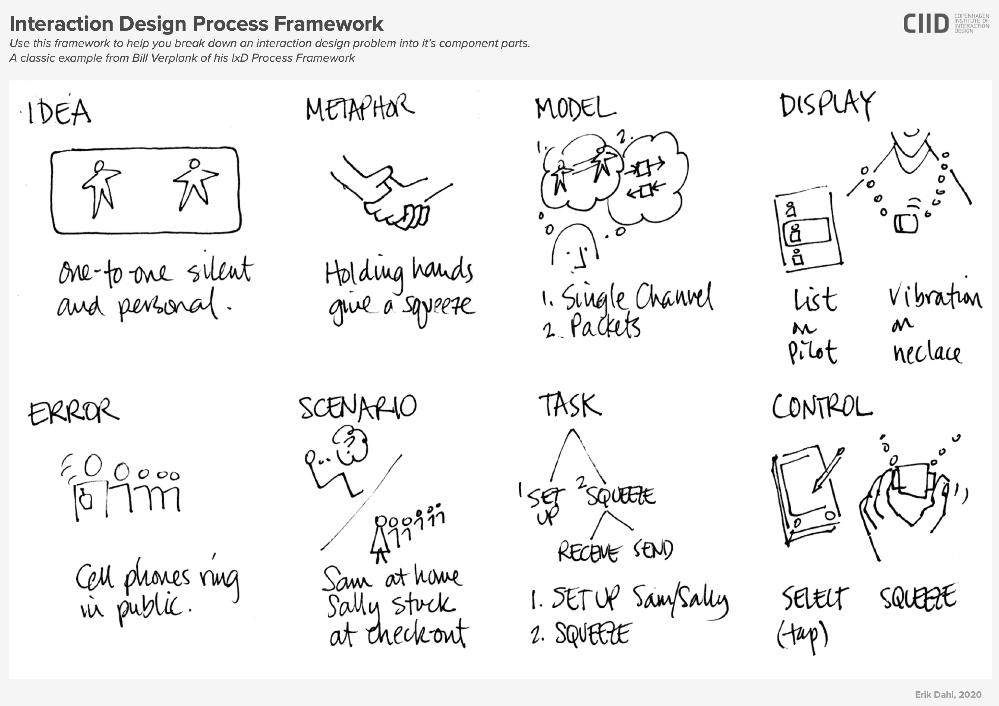

# Intro to interaction design

- Erik Dahl (https://www.dahl.studio/)
- Anthropologist, independent, been teaching at CIID since 2018

-----
# Day 01

who am I?

what do I hope to get out of this week?
- what's the grammer or communication

what is interaction design for me?
- any communication b/w two faces

what is an example of an interaction?
- operating an oven
- chatting with a chatbot

it's the language
we would be focusing on computational design than. many of the interactions would be 

goal: the platform for myself to build upon

interaction 

Edic: capitalism / interaction designs has been coopted by corporations. design is not art, by nature, it's made to be 'used' for others. there's tension b/w things we are making does not need to be coopted

interaction vs industrial - having a computational capability is something that interaction focuses on vs industrial

## History of Interaction Design

[Douglas Engelbart mother of all demos](https://youtu.be/yJDv-zdhzMY?si=YygepN5DYz4v_Trd)

[Ivan Sutherland Sketch](https://www.youtube.com/watch?v=6orsmFndx_o)- allowing the human to do most basic things and then the computation fixes and system augmenting human capabilities. uses compass as a metaphor to instruct drawing

a computational system also has limited capabilities, but it has the ability to simulate something in order for the person to percieve (almost like magic)

the first mouse. it occurred to him (transferred knowledge) from somewhere 

alan kay - xerox parc

mac / apple

ubiquitous computing - 

bill verplank - 3 main questions to (interaction )
1. how do you "do"? buttons(binary)/handles(continuous)
2. how do you "feel"? hot(exact information)/cold(ambiguious) reference: 
3. how do you "know"? map(allowing exploration)/path(direct instruction) - an understanding of how the system works

**how the system works and elements for designing an interaction for a system**
metaphor based relationship - use verb based metaphors vs noun based metaphor
there are multiple elements of a system that as a designer, I would need to consider and choose which one would fit best for the user and the context/situation. 

**Core interaction loop**
1. trigger - a cue for the user to take action eg: could be internal need, visual cue (advert) or even a task given/prompted
2. action - the input provided by the subject that was caused by the trigger
3. feedback - the response that the system provides after the action has been taken
4. reward/outcome - a series of actions & feedback would eventually come towards a larger reward or outcome (completed or mid-stage etc.)
5. progress/investment - a log/history of the entire sequence or iteration. Can be used for analysis or debugging purposes

In this loop, there are frictions that can hamper the interaction, usually
1. Cognitive friction - mental fatigue or there's too much to think and unclear
2. Operational friction - system isn't able to deliver at the pace, or extra/hidden information and interactions, errors or bugs
3. Emotional friction - when there's no reward, when progress isn't visible or clear

**Leban movement analysis**

## Design Brief

-----
# Notes / My Thoughts

Overall, it was an intense start to this week. The brief instigated us to think about

> Design and prototype and interactive “computational” artefact related to your experience adjusting to life at CIID as a temporarily remote student while the rest of the cohort is in Bergamo.

Now, given a situation or brief like this, the first question that comes to mind is "How do I go about thinking about this"? This was a brain explosion situation where a lot of things came to mind. Past conversations, some little exposure to design thinking methods or just plain and simple, my own way. So, I consciously had to shift gears to think about this more "structurally" that was not my own way.

## Step 01 - Ask questions
This step is usually called as observation, research and gathering some real data about this brief to question my assumptions. So a bunch of questions come to mind. The key here is really to understand the 'why' to generic statements

In this particular scenario, it made sense to ask questions (interivew as a research method). For a different brief, I probably would have used a different method - whatever begged to be seen/extracted. There are many methods of research, from qualitative to quantitative, interview to observation using photo/video or surveys, to google analytics or even heat maps. There are many ways to see and gather observations. For this particular brief interviewing someone made best sense. (side note: I'll write more about what mix/match of methods best fit a brief)

1. How do you **feel** joining CIID remotely?
2. What has your **daily schedule** affected since attending CIID remotely?
3. What are some **advantages/disadvantages** of doing the programme remotely?

These are starting points to begin with and then usually I followed it up with questions like

1. What is causing you to fee **feel** [that way]?
2. Why are you **feeling** [that way]?
3. Were you expecting to **feel** [that way]?
...

4. Tell me more about how your **daily schedule** was before CIID?
5. Can you be more specific about [changed **schedule**] and why might it be concerning?
...

6. What were some of the unexpected **advantages** that you didn't foresee?
7. Why is it a **disadvantage** [for that thing]?
...

I still feel, these are fairly unstructured set of questions, but more about being generally curious (i.e. my-way). The questions have to elicit "specific" points from the participant. The general points like "I am not enjoying doing this remotely" - is not a feedback that you can make sense from. There needs to be enough clues for diagnosis. 

**Example feedback**

"unable to connect with people at a personal level (staff, students & seniors) no freeflow/unstructured conversations"

> While that statement being true, we want you to break the problem into the smaller components, so it's easier to eventually ideate for those. You probebly won't be able to design one artifact that will solve all your issues, but you can design one that solve one specific aspect - Jose

A better question would have been to not have assumptions about `unable to connect` or be more clear about `personal level` and understanding differently for different groups like staff, students and seniors. Lastly being more clear about what they mean by `freeflow` or `unstructured`. 

A good tip is to anchor them to a specific 'time, action and person'

Q: Can you tell me about why you were unable to connect with a staff from CIID? How did that happen? (_trying to ground them into a specific situation_)
Q: Have you tried having a casual conversation with another student? how did it go like? (_regarding `no unstructured conversations` ground and concretise_)
Q: What does a typical conversation with a staff look like? How would that conversation go if you were in person with them? (_regarding `freeflow/unstructured conversations`_)

There's no wrong answer, there probably is only a wrong question. 🤷‍♂️ These questions would have triggered better responses, more specific ones that can be inferred.

## Step 02 - Synthesise the feedback & Interpret

**Cluster them**
Generally, when there's enough responses that are good, it would make this step easier to cluster into patterns. These groupings could be logical or categorical - it could also be scaled. I wonder what it would be like to group them on a standard deviation graph to identify commonalities as well as outliers. This part of the process has a name for it - affinity mapping (what seems similar ref: universal methods of design)

**Deriving an insight**
Here's the part where you unearth, uncover through interpreting the sentence/groupings/themes. The interpretation should state "my" interpretation of why that feedback was given in the first place. This is better done than said, needs practice. A more structured way to interpret is using this 

1. Observation: what happened or was said, with no interpretation. Eg: "The remote student only learns about the decisions made when someone says ‘as we discussed.’"
2. Pattern/Cluster/Theme: the same thing recurring across people or clusters. "Four of seven students learn about changes only after the fact."
3. Interpretation (the "why"): the underlying need, belief, or mechanism that explains the pattern is something is comes from my assumptions/beliefs. In this case, it would be "The remote students don’t know what they don’t know, so they can’t ask or assume."
4. Insight: a statement that combines the pattern and the why, usually with a tension, and that opens a design question. It should be framed as “so what”, not “so build this”.

An insight should tell you 'what' is true and 'why'. Some ways to validate a good insight:

- Can I point to at least 3 people and 2 clusters? If not, it’s a hunch.
- Would a team member be surprised? If not, dig deeper into the why.
- Could I swap “remote students” for any group and it still works? If so, it’s too generic.
- Does it contain a solution? If so, strip the solution out and see what’s left.
- Does it name a tension? If not, look for what the student is trading off.

## Step 03 - Frame how-might-we

How might we <do something>
for <type of people>
in <context>
that <goal/intent/feeling/outcome>

The framing is essentially, taking the insight and framing it such a way that it is able to identify. The first 2 should MUST be defined, the rest are optional and good to have
1. ✅ **Action** - the action that is required to be taken in order to achieve the goal (2)
2. ✅ **Goal/Intent** - what is the user trying to achieve and what's the intent behind doing the action - This basically should align from the data gathered earlier from which you derived the insight
3. ⚠️ **Context** - if you are able to explain a context in which the user would be using it, that's great
4. ⚠️ **Type of Person** - if you are able to define the persona/person for whom you are solving it, that's great

This is crucial because, it's essentially going to act at as a starting point from where you'll ideate, generate ideas, brain storm etc.

-----

# Day 02

## Know-Do-Feel

We started seeing bill verplank's framework of breaking down the elements of an interaction. Generally started off by understanding the 'know-do-feel' interaction loop. According to Bill Verplank, there are 3 main questions that an interaction designer needs to ask:

**Do**
It starts by attracting the user to 'do' and perform an action using the example of 
1. button - a more binary action that only has 2 states
2. handle - a way to maniupulate the input in a more discrete way, more than just binary - a way to 'handle' and control the input in a more nuanced way

**Feel**
Usually after the user 'does' something, the feedback from the system is how it would make the user 'feel' something. These are generally categorised in
1. cold - a more open ended response where the user needs to spend sometime in interpreting the response (invokes participation)
2. hot - a more direct response that would make the user get a reponse without much interpretation (high-sensory/spoon-fed)
Best products have 'cool' attractors to engage new visitors as well as definitive 'hot' information that provide clear information and outputs

**Know**
The combination of doing and feeling, would then trigger the user to understand the system by 'knowing' it better. It's the mental-model that the system creates in the user's head by the above 'doing' and 'feeling' by interacting with the system. Here there are two kinds of mental models that could be created generally
1. map - some problems require maps, where landmarks and layout of the solution help communicate the user how to navigate. Good for empowering the user to chart own's path
2. path - some problems require a predetermined set of steps that the user can follow. Good for consistent repetitive workflow

## Interaction design process framework

A useful framework to break down an interaction design problem into it's components. Generally consisting of

| IDEA  | METAPHOR | MODEL | DISPLAY |      --> motivation | meaning | models | mappings            <equivalent terms>
--
| ERROR | SCENARIO | TASK  | CONTROL |      --> observation | invention | engineering | appearance  <processes involved>

This framework is useful after defining a specific problem statement in mind (after defining the HMW). 

- https://www.youtube.com/watch?v=2lXh2n0aPyw - how can we get more people to choose the stairs by making it fun to do?
- https://vimeo.com/40980676 - how can a boring footpath area be more fun and attract crowd to spend more time there.

### Feedback

**Start**
- I feel you seem be missing the point at times, about what needs to be done
- It would help for you to listen more openly, with an open mind
- maybe take some time to unlearn and get some fresher perspective rather than relying on past experience at times

**Continue**
- to be confident about your past experience and draw anecdotes from it
- to reach out to others whenever they might need help (thanks for that)
- be expressive about your thoughts. I think you are pretty direct in sharing your thoughts, which is great

**Stop**
- thinking that this course might not be worth it, there's still something you can learn even though it might be repetitive

**feedback for Vivek from Rishi**
- don't compete with them
- stop saying it's fine and that it's bothering us
- don't push yourself so much that it starts affecting the collobration, work that I am doing
- dont' be too hard on yourself, chill a bit

let's share our personal contracts with each other

-----

# Day 03

## Feedback on the interaction design framework
- a lot of notes taken on figma

## Design principles

[Don norman's principles](https://uxdesign.cc/ux-psychology-principles-seven-fundamental-design-principles-39c420a05f84)

1. Discoverability - just by looking at something, what do you assume it can do
2. Feedback - how does the system communicate when the user interacts with it, the way the system is giving a feedback
3. Mental Model - eg: a digital (apple) pen uses the model of a real pencil that has an eraser at the top of it. Thus, the digial pen trying to replicate that model of flipping it to erase it on the digital screen
4. Affordance - the relationship b/w human vs the object. eg: does the object invite you to interact with it and how?
5. Signifier - using communication to notify the user about taking some action
6. Mapping - relationship b/w control & feedback/action'

## Leban;s framework
- https://www.erikdahl.io/writing/2016/4/19/embodied-interactions-and-emotions

What if there were notations, just like in music, but also for dancing? The link (article) above written by Erik, explores the connection between the human body movement and emotion. The Laban's framework was originally designed for dancing, but Erik explored how this would also fit into "physicality or posture of product design". 
The framework especially was divided into 3 main factors

1. Weight = Light  ↔️ Strong
2. Space  = Direct ↔️ Indirect
3. Time   = Sudden ↔️ Sustained

Particularly, I feel, this framework might be useful is in situations where there're movement based interactions. It could also be applied to analyse, interaction animations or animations in general. I wonder how these are applied to mathematical functions and bezer curved functions that are used for interactions on the web. I intend to write about this sometime soon/someday. Although it seems like giving these funtions, a more human name using this framework. Sort of like a guide for people to use appropriate function based on a specific use case. 

## Bodystorming
- _something that happened in the Atrium_

## Sketching, Storyboarding and Prototyping

**Prototyping**
- Spend least amount of time and resources to make a prototype
- Always have a compass (a question that we are trying to answer) when prototyping - so that it actually adds value in solving the problem rather than focusing on something else like - _how it looks_
- Time box prototyping. Time is different from the compass, the compass defines the direction and the time defines the how fast you want to get there
- a model is specifically different from a prototype. The diff is, model describes the setting/setup of the product where as the prototype allows someone to use/play with the 

**Storyboarding**
- a visual representation of someone interacting with the prototype/product
- can be used to 

**Flows & Timelines**
- A tool to detail out the interaction for a fairly complex set of interaction
- A flow map and states of the interaction

-----

# References
- Leban movement analysis - to understand human behaviour through their movement like body, effort, shape and space
- universal methods of design
- interaction aesthetics: https://boxesandarrows.com/foundations-of-interaction-design/. In order to have any sort of productive discussion about aesthetics we need to start by understanding our language, how can we describe aesthetic and formal aspects of a solution in a way that others will understand
- https://uxdesign.cc/ux-psychology-principles-seven-fundamental-design-principles-39c420a05f84 - 7 design principles

-----

# Some Ideas

- small intelligences: eg: a cardboard box having some intelligence that is 'closed' or 'being kicked around' or if it's full/empty' etc. making dumb objects into smarter objects that then has the ability to 'interact' to others
-  

Erik definitely pushed us in newer directions and beyond by asking many questions. Be shameless in asking every detail of the interaction.. which is out of my comfort zone, which are the things I need to answer for a product that I am designing. Also, get feedback surely

**Challenging**
- was definitely very exhausting working with Rishi - trying to convince and sticking to the framework (or making him)
- just complicating things and not sticking to the framework, coming up with new ideas and new direction every now and then - fcking exhausting

**Take away**
- Miscommunication, team-discipline and open-ness
- We should have split our tasks in a linear fashion rather than both doing all tasks simultaneously
- 

# TODO / 
- catchup on the sessions
- 2 min video explaining the product and the interactions
- 

-----

# Summary

**In a nutshell:** Interaction design shapes the conversation between a person and a system. Ask better questions, turn the answers into an insight, frame it, then design what people *do*, *feel* and *know*.

## From brief to question
1. **Ask:** anchor people to a specific *time, action and person*. "I can't connect with people" is too vague to design for.
2. **Synthesise:** cluster responses (affinity mapping), then move from **observation → pattern → interpretation → insight**.
3. **Frame:** *How might we* (action) *for* (people) *in* (context) *that* (goal). Action and goal are musts.

**Testing an insight**
- At least 3 people and 2 clusters support it; otherwise it's a hunch.
- It would surprise a team member.
- It's specific to this group.
- It names a tension.
- It contains no solution: "so what", not "so build this".

## Frameworks

**Bill Verplank: Do, Feel, Know**

| Question | Options |
|---|---|
| How do you **do**? | Button (binary) ↔ handle (continuous control) |
| How do you **feel**? | Cold (open, needs interpretation) ↔ hot (direct, explicit) |
| How do you **know**? | Map (explore your own way) ↔ path (follow the steps) |

His process framework takes a defined problem through: idea / error → metaphor / scenario → model / task → display / control. For metaphors, verbs work better than nouns.

**Core interaction loop:** trigger → action → feedback → reward → progress. Friction in it can be **cognitive** (unclear), **operational** (slow, hidden, buggy) or **emotional** (no reward or visible progress).

**Don Norman's principles:** discoverability, feedback, mental model, affordance, signifier, mapping.

**Laban, for movement and animation:** weight (light ↔ strong), space (direct ↔ indirect), time (sudden ↔ sustained).

## Making
- **Prototype:** least time and resources, guided by a *compass* (the question to answer) and a *timebox*.
- **Model vs prototype:** a model describes the setup; a prototype can be used.
- **Storyboards** show someone interacting with it; **flows** detail complex interactions and their states.

## History worth remembering
Engelbart's mother of all demos, Sutherland's Sketchpad, Alan Kay and Xerox PARC, ubiquitous computing. The thread: computation that augments people, and metaphors that make it understandable.

## Reflections
- Be shameless about asking every detail of an interaction, and get feedback early.
- Collaboration was the hard part: miscommunication, discipline and openness. Splitting tasks linearly would have worked better than both of us doing everything at once.
- **Feedback I got:** don't compete, stop saying "it's fine", don't push so hard that collaboration suffers, and be less hard on myself.

## Loose ends
- Norman's seventh principle is missing: *constraints*.
- Laban's effort also has a fourth factor, *flow*, and the spelling is *Laban*.
- "Handle" is described as "discrete" on Day 02, but it's the *continuous* one (as on Day 01).
- The blank hot/cold reference is likely Marshall McLuhan's hot and cool media.
- Bodystorming and storyboarding notes are unfinished.
- To do: catch up on sessions, make the 2-minute product video.
